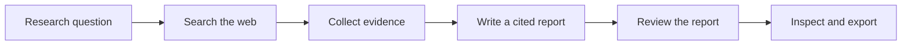
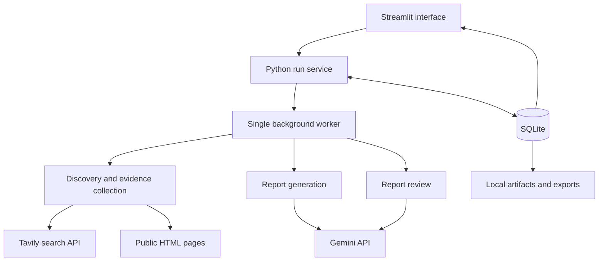

# Synapse

[](https://www.python.org/)
[](https://www.crummy.com/software/BeautifulSoup/)
[](https://www.sqlite.org/)
[](https://streamlit.io/)


**Turn a research question into a report with sources you can inspect.**

Synapse is a local research assistant that brings web search, evidence collection,
report writing, and report review into one Streamlit app. Enter a question, add optional
subquestions, and search for relevant pages through Tavily. Synapse extracts readable
text from those pages and saves selected passages as evidence. Gemini then uses that
saved evidence to write a cited report.

The report is the starting point for inspection. Each citation connects a claim to a
saved passage, so you can read the evidence behind an answer without repeating the
search. A separate review evaluates evidence support, coverage, source quality,
uncertainty, and clarity, with comments linked to individual claims. These scores are
model judgments that help you review the report; they do not guarantee that every
conclusion is correct.

Research stays on your machine in SQLite and local files. You can reopen earlier runs,
inspect their sources and collection errors, and download results as Markdown or JSON.
An offline demonstration uses predetermined sample data so you can explore the full
workflow without API keys. Live research sends search requests to Tavily and selected
research inputs to Gemini.

## Features

- **Focused web research:** start with a question, add subquestions, and apply a date
  filter to guide discovery.
- **Inspectable evidence:** read the exact saved passages behind report citations,
  alongside their source links and retrieval details.
- **Cited report generation:** generate a report from collected evidence, with checks
  that citation IDs resolve and quotations match their referenced passages.
- **Claim-level review:** see five review scores and comments linked to the claims
  they assess, then inspect the supporting evidence yourself.
- **Persistent research history:** reopen saved runs with their sources, reports,
  reviews, and recorded progress.
- **Portable results:** export complete or partial research as Markdown and JSON.
- **Offline demonstration:** explore sample success and evidence-gap scenarios without
  external services or credentials.

## Core Pipeline



1. **Search:** turn the question and subquestions into a bounded set of search queries.
   Retrieve relevant page links through Tavily and retain their search context.
2. **Collect evidence:** fetch supported HTML pages, remove navigation and other
   distracting content, and select relevant passages. Save those passages with source
   links, publication dates when available, and retrieval details.
3. **Write:** explicitly request a Gemini report using the saved evidence. Validate
   that citations refer to evidence from the same run and quoted text matches the
   referenced passage before presenting the report.
4. **Review:** explicitly request a separate assessment across five criteria, each
   scored from 0 to 2. Show the total out of 10 and comments linked to report claims.

Live discovery pauses once sources are ready. You choose when to generate the report
and when to evaluate it, giving you an opportunity to inspect the evidence between
stages. If a later stage fails, earlier saved results remain available.

## Tech Stack

| **Layer** | **Tools** | **Purpose** |
| --------- | --------- | ----------- |
| Language | Python 3.12 / 3.13 | Application logic and pipeline execution |
| Interface | Streamlit | Research controls, progress, evidence inspection, and downloads |
| Search | Tavily API | Discover relevant web pages |
| Report generation and review | Gemini API | Write cited reports and assess them against a rubric |
| Content extraction | Beautiful Soup 4 | Parse HTML and extract readable page text |
| Networking | urllib3, dnspython | Fetch pages with bounded requests and destination checks |
| Data validation | Pydantic | Define and validate structured research data |
| Storage | SQLite, local files, filelock | Persist runs, produce artifacts, and coordinate store ownership |
| Pipeline execution | Python service with one background worker | Run stages while the interface displays progress |
| Development and testing | uv, pytest, Streamlit AppTest, Ruff, mypy | Manage dependencies and verify behavior, style, and types |

## Repository Structure

```text
Synapse/
  src/synapse/
    ui/
      app.py           Streamlit interface and research controls
      resources.py     Shared service setup for the interface
    discovery.py       Query planning and search coordination
    search.py          Tavily search integration
    fetch.py           HTML extraction and evidence selection
    network.py         Bounded HTTP connections and URL checks
    synthesis.py       Gemini report generation from saved evidence
    critic.py          Gemini report review and scoring
    models.py          Typed contracts for research inputs and outputs
    validation.py      Evidence, citation, and report integrity checks
    service.py         Stage coordination and background processing
    storage.py         SQLite persistence, artifacts, and recovery
    export.py          Markdown and JSON export
    fixtures.py        Offline demonstration adapters
    fixtures/          Curated sample research data
    cli.py             Command-line entry point
  tests/               Automated behavior and failure-path tests
  docs/                Requirements, architecture, build plan, and status
  pyproject.toml       Package metadata and development configuration
  uv.lock              Locked dependency versions
```

Generated research data is stored separately in `data/synapse/` by default. It is
runtime output rather than part of the versioned sample fixtures.

## Architecture

Synapse runs as a local, single-user application. The Streamlit interface handles user
input and presents results. A Python service coordinates the research stages through
one background worker, while dedicated modules handle search, page extraction,
generation, and review.



### Interface and Execution

The interface submits explicit actions to the run service: start discovery, generate
a report, or evaluate a report. The worker performs the requested stage, and the
interface reads saved progress and results. Streamlit reruns do not automatically
submit new research or repeat provider calls. The local service processes one job at
a time.

### Evidence and Generation

Discovery finds candidate pages through Tavily. The fetch layer checks destinations,
limits response sizes and request duration, and uses Beautiful Soup to extract readable
text from supported HTML. Selected excerpts are saved with stable identifiers and
source metadata.

Report generation receives the question, source metadata, and saved excerpts. It does
not browse for additional sources. Application validation checks citation ownership
and literal quotations before accepting the output. The review stage separately
assesses the saved report and evidence, returning bounded scores and claim-linked
comments. Valid citation links establish traceability; readers still need to judge
whether the passages support the conclusions.

### Storage and Recovery

SQLite is the authoritative store for run state, structured stage outputs, and ordered
events. Local files hold derived artifacts and exports that can be regenerated from
saved data. Transactional updates keep progress and stage results consistent, and a
file lock prevents a second process from taking ownership of the same store.

If the application restarts during a job, that interrupted work is marked as failed
rather than silently resumed. Previously saved outputs remain inspectable, including
partial research and a report whose later review failed.

### Offline and Live Modes

The offline demonstration uses deterministic fixture adapters to exercise the workflow
without network access or API keys. Live mode uses Tavily for discovery and Gemini for
generation and review, with server-side configuration gates and application-enforced
request and token budgets. The same interface supports inspecting saved results from
either mode.

## Getting Started

### Requirements

- Python **3.12 or 3.13**
- [uv](https://docs.astral.sh/uv/getting-started/installation/)
- For web research: **Tavily** and **Gemini** API keys

### Installation

```bash
git clone https://github.com/ayatinkering/Synapse.git
cd Synapse
uv sync --locked
```

### Try the Offline Demo

```bash
uv run --no-sync streamlit run src/synapse/ui/app.py --server.address 127.0.0.1
```

Open the local URL printed in the terminal, usually **http://127.0.0.1:8501**.
Select **Offline demonstration**, choose a scenario, and click **Start offline run**.
The sample sources, reports, and scores are predetermined so you can explore the app
without external services.

### Research with Live Sources

Create a `.env` file in the project directory:

```dotenv
TAVILY_API_KEY=your_tavily_key
GEMINI_API_KEY=your_gemini_key
```

Load the keys and enable live research in a Bash terminal. This example assumes you
have confirmed that your Gemini project uses the free tier:

```bash
set -a
source .env
set +a
export SYNAPSE_ENABLE_LIVE=1
export SYNAPSE_ENABLE_SYNTHESIS=1
export SYNAPSE_ENABLE_CRITIQUE=1
export SYNAPSE_GEMINI_FREE_TIER=1
uv run --no-sync streamlit run src/synapse/ui/app.py --server.address 127.0.0.1
```

The app reads environment variables; it does not load `.env` automatically. Keep keys
private. Provider quotas and billing still apply; the free-tier setting does not cap charges.

The default Gemini model is `gemini-3.5-flash-lite`. Set `SYNAPSE_GEMINI_MODEL` before
launching to use another compatible model.

## Using Synapse

1. Choose **Live discovery** and enter a topic and research question.
2. Add optional subquestions or a date filter, review the queries, and click
   **Start live discovery**.
3. Inspect the collected sources and passages, then click **Generate cited report**.
4. Click **Evaluate report** to see the review and scores.
5. Follow citations, read claim-linked comments, or download the results as Markdown
   or JSON.

| **Tab** | **What you'll find** |
| ------- | -------------------- |
| Report | The report, its claims, and the evidence behind each claim |
| Sources & Evidence | Saved passages, source details, dates, and collection errors |
| Critique | Five review scores and comments linked to specific claims |
| Run Details | Research settings, usage, and the sequence of completed steps |

Use **Recent runs** to reopen earlier research. Results are stored locally in
`data/synapse/`; set `SYNAPSE_DATA_DIR` to choose a different directory. Saved runs
remain inspectable without provider credentials.

## Development

```bash
uv run --no-sync ruff check .
uv run --no-sync ruff format --check .
uv run --no-sync mypy
uv run --no-sync pytest -m 'not live'
uv build
```

The default tests run without API keys or network access. They cover evidence
extraction, citation checks, report scoring, persistence, exports, interface behavior,
and important failure paths. Live provider checks are separate, opt-in tests.
