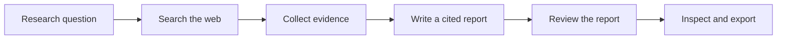

# Synapse

[](https://www.python.org/)
[](https://streamlit.io/)

**Turn a research question into a report with sources you can inspect.**

Synapse searches the web, collects relevant passages, and uses Gemini to write a cited
research report. It then reviews the report for evidence support, coverage, source
quality, uncertainty, and clarity.

Each report stays connected to its saved sources. You can inspect the original passages,
revisit previous research, and download your results as Markdown or JSON.

## Features

- **Web research:** search by question, add subquestions, and filter by date.
- **Traceable answers:** follow a report's citations to the exact saved passages.
- **Report review:** see a five-part score and comments linked to individual claims.
- **Research history:** reopen saved runs with their sources, reports, and reviews.
- **Portable results:** export complete or partial research as Markdown and JSON.
- **Offline demo:** explore the workflow with sample data and no API keys.

## Core Pipeline



1. **Search:** turn the question and subquestions into search queries and retrieve
   relevant pages through Tavily.
2. **Collect evidence:** extract readable text from the pages and save relevant passages
   alongside source links, dates when available, and retrieval details.
3. **Write:** ask Gemini to produce a report using the saved evidence. Check that cited
   passages exist and quoted text matches the source.
4. **Review:** assess the report across five criteria, each scored from 0 to 2. Display
   the total out of 10 with comments linked to the report's claims.

## Tech Stack

| **Layer** | **Tools** |
| --------- | --------- |
| Language | Python 3.12 / 3.13 |
| Interface | Streamlit |
| Search | Tavily API |
| Report generation and review | Gemini API |
| Content extraction | BeautifulSoup |
| Networking | urllib3, dnspython |
| Data validation | Pydantic |
| Storage | SQLite, local files, filelock |
| Pipeline execution | Python service with a background worker |
| Development and testing | uv, Pytest, Streamlit AppTest, Ruff, mypy |

## Getting Started

### Requirements

- Python **3.12 or 3.13**
- [uv](https://docs.astral.sh/uv/getting-started/installation/)
- For web research: **Tavily** and **Gemini** API keys

### Installation

```bash
git clone https://github.com/ayatinkering/Synapse.git
cd Synapse
uv sync --locked
```

### Try the Offline Demo

```bash
uv run --no-sync streamlit run src/synapse/ui/app.py --server.address 127.0.0.1
```

Open the local URL printed in the terminal, usually **http://127.0.0.1:8501**.
Select **Offline demonstration**, choose a scenario, and click **Start offline run**.
The sample sources, reports, and scores are predetermined so you can explore the app
without external services.

### Research with Live Sources

Create a `.env` file in the project directory:

```dotenv
TAVILY_API_KEY=your_tavily_key
GEMINI_API_KEY=your_gemini_key
```

Load the keys and enable live research in a Bash terminal. This example assumes you
have confirmed that your Gemini project uses the free tier:

```bash
set -a
source .env
set +a
export SYNAPSE_ENABLE_LIVE=1
export SYNAPSE_ENABLE_SYNTHESIS=1
export SYNAPSE_ENABLE_CRITIQUE=1
export SYNAPSE_GEMINI_FREE_TIER=1
uv run --no-sync streamlit run src/synapse/ui/app.py --server.address 127.0.0.1
```

The app reads environment variables; it does not load `.env` automatically. Keep keys
private. Provider quotas and billing still apply; the free-tier setting does not cap charges.

The default Gemini model is `gemini-3.5-flash-lite`. Set `SYNAPSE_GEMINI_MODEL` before
launching to use another compatible model.

## Using Synapse

1. Choose **Live discovery** and enter a topic and research question.
2. Add optional subquestions or a date filter, review the queries, and click
   **Start live discovery**.
3. Once sources are ready, click **Generate cited report**.
4. Click **Evaluate report** to see the review and scores.
5. Inspect the results or download them as Markdown or JSON.

| **Tab** | **What you'll find** |
| ------- | -------------------- |
| Report | The report, its claims, and the evidence behind each claim |
| Sources & Evidence | Saved passages, source details, dates, and collection errors |
| Critique | Five review scores and comments linked to specific claims |
| Run Details | Research settings, usage, and the sequence of completed steps |

Use **Recent runs** to reopen earlier research. Results are stored locally in
`data/synapse/`; set `SYNAPSE_DATA_DIR` to choose a different directory.

## Project Structure

```text
src/synapse/
  ui/                Streamlit interface
  discovery.py       Query planning and search coordination
  search.py          Tavily integration
  fetch.py           Page extraction and evidence selection
  network.py         Bounded HTTP connections and URL checks
  synthesis.py       Cited report generation
  critic.py          Report review and scoring
  models.py          Typed research data
  service.py         Background processing
  storage.py         Saved runs and recovery
  export.py          Markdown and JSON export
  fixtures.py        Offline demonstration adapters
  fixtures/          Sample research data
tests/               Automated tests
```

## Development

```bash
uv run --no-sync ruff check .
uv run --no-sync ruff format --check .
uv run --no-sync mypy
uv run --no-sync pytest -m 'not live'
uv build
```

The default tests run without API keys and cover evidence extraction, citation checks,
report scoring, persistence, exports, and interface behavior.
