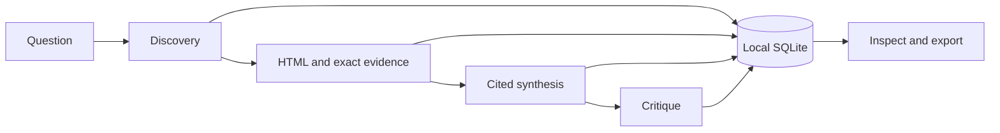

# Synapse

[](https://www.python.org/)
[](https://streamlit.io/)
[](https://github.com/ayatinkering/Synapse/actions/workflows/ci.yml)

**A local research assistant that turns a question into inspectable sources, a cited report, and a model critique.**

Synapse saves the evidence behind its answers. Open a claim to see the exact excerpt,
source metadata, and character offsets; reopen the run later or export it as Markdown
and JSON. An offline demonstration works without API keys.

## What Synapse Does

| Capability | Behavior |
|---|---|
| Discover | Search with Tavily using the question and up to two distinct subquestions |
| Collect evidence | Fetch public HTML, clean and bound the text, select exact excerpts |
| Write a report | Use Gemini to generate claims linked to saved evidence |
| Critique | Score five dimensions and return findings linked to report claims |
| Inspect and export | Browse sources, claims, findings, limits, usage, and saved runs |
| Demonstrate offline | Run two synthetic scenarios with predetermined reports and critiques |

A valid citation proves that its excerpt exists in the saved source. It does **not**
prove the claim is true. A model critique is a review aid, not an independent fact check.

## Core Pipeline



1. **Discovery:** preview deterministic queries and search public sources. Search
   snippets are metadata; they cannot become evidence.
2. **Analysis:** fetch selected pages, remove navigation/scripts/forms, and save up to
   three excerpts per source using a deterministic relevance heuristic.
3. **Synthesis:** generate one structured report using the saved question and evidence.
   Reject invalid evidence IDs, altered quotations, malformed output, and budget violations.
4. **Critique:** evaluate grounding, coverage, source quality/diversity, uncertainty,
   and clarity/actionability. Each scores 0–2; the application calculates the total
   out of 10 and validates every finding's claim ID.

Live stages use explicit buttons: **Start live discovery → Generate cited report →
Evaluate report**. Each model stage allows one attempt per run, with no automatic retry,
repair, or revision. Failed or cancelled runs preserve their saved outputs and export
as incomplete bundles.

## Quick Start

### Requirements

- Python **3.12 or 3.13**
- [uv](https://docs.astral.sh/uv/getting-started/installation/)
- Optional for live runs: a **Tavily API key** and a **Gemini API key**

### Install

From your checkout:

```bash
uv sync --locked
```

### Run the Offline Demo

```bash
uv run --no-sync streamlit run src/synapse/ui/app.py --server.address 127.0.0.1
```

Open the address printed by Streamlit, usually **http://127.0.0.1:8501**.
Choose **Offline demonstration**, select a scenario, then press **Start offline run**.
The comparison scenario completes all four stages; the sparse scenario demonstrates
an evidence gap. All offline sources, scores, and findings are synthetic.

### Run with Live Sources

Put your keys in a local, ignored `.env` file:

```dotenv
TAVILY_API_KEY=your_tavily_key
GEMINI_API_KEY=your_gemini_key
```

The app reads environment variables; it does not automatically load `.env`. In a Bash
terminal, load your own file and enable the stages before launching:

```bash
set -a
source .env
set +a
export SYNAPSE_ENABLE_LIVE=1
export SYNAPSE_ENABLE_SYNTHESIS=1
export SYNAPSE_ENABLE_CRITIQUE=1
export SYNAPSE_GEMINI_FREE_TIER=1
uv run --no-sync streamlit run src/synapse/ui/app.py --server.address 127.0.0.1
```

Set the free-tier confirmation only after checking your Gemini project's tier. It is a
configuration gate, not an enforceable billing cap. Tavily calls and retries can consume
credits; provider usage is recorded when returned, while monetary cost remains unknown.
Never enter API keys in research fields or commit them to Git.

Choose **Live discovery**, enter a topic/question and optional subquestions/date filter,
then review the preview and start. Once sources are ready, generate the report; once
it is ready, evaluate it. Source failures and missing stages remain visible. No provider
call starts merely by opening or refreshing a saved run.

Default model: **`gemini-3.5-flash-lite`**. To select another compatible model, set
`SYNAPSE_GEMINI_MODEL` before launch. Restart after changing server configuration.
Saved runs and the offline demo remain available without credentials.

## Inspecting a Run

- **Report:** read claims and inspect their exact evidence.
- **Sources & Evidence:** check URLs, failures, dates, truncation, hashes, and snapshots.
- **Critique:** inspect the five scores, evaluator identity, and claim-linked findings.
- **Run Details:** inspect configuration, provider usage, and ordered events.

Use **Recent runs** or a run's URL to reopen it. **Download Markdown** and **Download JSON**
contain the same run, source, evidence, report, and critique data. Missing stages are
never invented; SQLite can regenerate missing derived export files.

## Storage and Limits

Data lives in ignored `data/synapse/`. Set `SYNAPSE_DATA_DIR` to use another directory.
One process owns a directory and one job runs at a time. Restart marks unfinished work
interrupted; there is no automatic resume. Cancellation is cooperative.

| Default limit | Value |
|---|---|
| Queries / results per query / selected sources | 3 / 5 / 10 |
| Cleaned text per source | 3,000 characters |
| Download / fetch-attempt budget | 2 MB / 15 seconds |
| Model input preflight / output cap, per stage | 8,192 / 2,048 tokens |
| Model request / stage-job deadline | 30 / 600 seconds |

Token preflight is an estimate; actual returned usage is checked afterward. Lost or
cancelled responses can have unknown usage. Search/fetch transient retries are bounded;
model calls have no retries. Date preferences are search filters, not verified page dates.

## Repository Structure

```text
src/synapse/
  models.py          Typed runs, sources, evidence, reports, critiques
  discovery.py       Query planning and discovery orchestration
  search.py          Tavily adapter
  fetch.py           Bounded HTML fetching and evidence extraction
  network.py         DNS, pinned connections, response/deadline limits
  synthesis.py       Gemini transport, budgets, and cited report generation
  critic.py          Five-dimension critique over saved evidence
  service.py         Single worker and stage submission
  storage.py         SQLite persistence and recovery
  export.py          Validated Markdown/JSON exports
  fixtures/          Bundled offline demonstrations
  ui/                Streamlit application
tests/                Offline regressions and opt-in live checks
docs/                 Requirements, architecture, milestones, verification
```

## Testing

```bash
uv run --no-sync ruff check .
uv run --no-sync ruff format --check .
uv run --no-sync mypy
uv run --no-sync pytest -m 'not live'
uv build
```

Default tests run offline with temporary SQLite databases and injected network responses.
CI checks Python 3.12/3.13 and executes the built wheel outside the checkout. Tests cover
citation/score validation, budgets, failures, cancellation, persistence, exports, and
Streamlit interactions. Live tests are opt-in and require separate authorization and
local credentials. See [STATUS](docs/STATUS.md) for actual commands, model usage, browser
checks, and limitations; passing tests are not a research-quality benchmark.

## Current Scope

The first four-stage local workflow is implemented. Revision and measured evaluation
remain future milestones. HTML only: no PDF/OCR, paywall bypass, arbitrary browser
research, background scheduling, or multi-user hosting. URL/hash deduplication does not
establish independent authorship. Source extraction and model judgments can be wrong;
review evidence before relying on a report. Public hosting needs additional access
controls and constrained network egress.

[Requirements](docs/PRD.md) · [Architecture](docs/ARCHITECTURE.md) ·
[Build plan](docs/BUILD_PLAN.md) · [Verified status](docs/STATUS.md)
